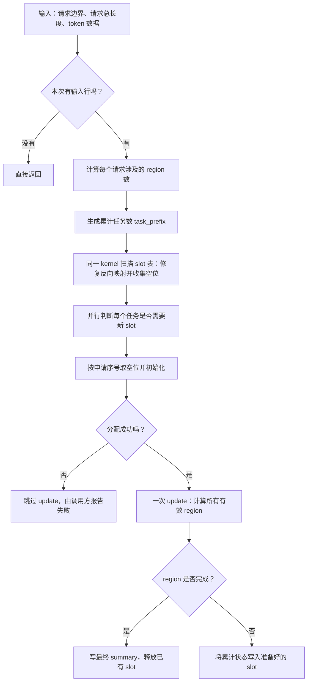
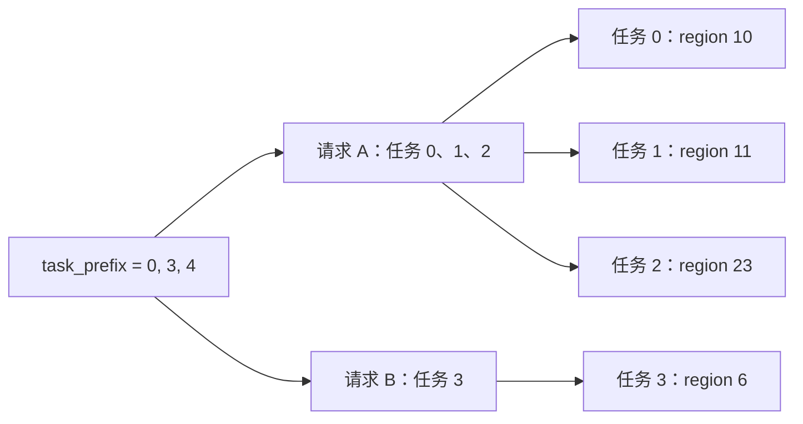
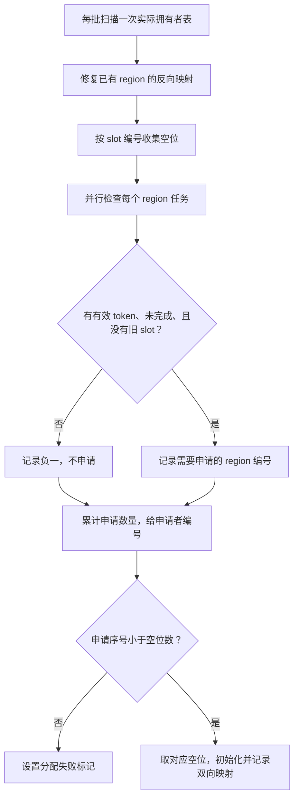
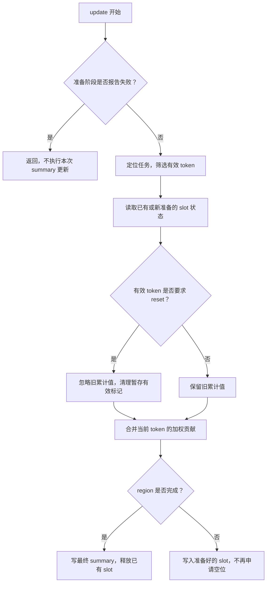

# Step4 prefill summary：按请求生成 region 任务

> 当前普通提示词纯 prefill 已接入 [runner 分配方案](step5_prefill_runner_slots.md)，每层只启动一次 summary update。本文的四阶段设备方案作为混合批次等情况的回退路径保留。

> 上游已将 Step4 重命名为 Step5；当前源码位于 `vllm_ascend/models/step5/`，本文沿用原方案名称。

本文解释当前代码如何从请求信息生成 region 任务，以及如何计算和保存 summary。所有图和示例都围绕这一套算法展开。

## 1. 先认识算法处理的对象

模型把文本转换成一串 token，每个 token 可以理解为一个输入单位，不一定对应一个汉字。一个请求的输入可以分几次处理，本次处理的部分称为一个 chunk。prefill 指处理输入文本的阶段。

多个请求本次需要处理的 token 放在一起，组成一个批次。每个 token 在批次中占一行，行号从 0 开始。

一个请求的序列位置按固定长度划成 region。本文用 **每个 region 有 8 个位置** 举例：

```text
序列位置： 0 1 2 3 4 5 6 7 | 8 9 10 11 12 13 14 15 | 16 17 18 ...
逻辑region：     第0个      |          第1个          |   第2个
```

“逻辑 region”表示按请求内的位置划分的一段。实际存储时，每段还会被映射到缓存中的一个实际 region 编号。缓存是保留数据、供后续计算使用的内存。

summary 是一个 region 内 token 数值的加权汇总结果，不是自然语言摘要。一个 **任务** 负责把本批次属于一个 region 的 token 合并到它的 summary 状态中。

如果 region 尚未处理完，就保存中间结果；处理到最后一个位置时，才保存最终 summary。保存中间状态的一个存储位置称为 active slot，后文简称 slot。

## 2. 全流程图

kernel 是提交给设备执行的计算程序。当前流程包含四个 kernel 调用：任务计数和空位收集、申请判断、按序分配、一次 summary 更新。



四个 kernel 按顺序执行。slot 准备阶段不会提前释放任何已有 slot，因为 update 仍可能需要读取其中的旧累计状态。

## 3. 贯穿全文的输入例子

本批次有请求 A、B。region 大小为 8：

| 请求 | 之前已处理的 token 数 | 本次 token 数 | 本次结束后的总长度 | 本批次输入行号 |
| --- | --- | --- | --- | --- |
| A | 6 | 12 | 18 | 0～11 |
| B | 0 | 5 | 5 | 12～16 |

请求 A 从序列位置 6 继续处理，请求 B 从位置 0 开始：

```text
请求 A：
序列位置    6  7 | 8  9 10 11 12 13 14 15 | 16 17
输入行号    0  1 | 2  3  4  5  6  7  8  9 | 10 11
实际region  10   |           11           |   23

请求 B：
序列位置    0  1  2  3  4
输入行号   12 13 14 15 16
实际region        6
```

实际 region 编号 10、11、23、6 是示例中的缓存编号，不由本批次的行号推算，也不必连续。

对应的输入数组如下：

```python
query_start_loc = [0, 12, 17]
seq_lens = [18, 5]

flat_slot = [10, 10, 11, 11, 11, 11, 11, 11, 11, 11, 23, 23,
             6,  6,  6,  6,  6]

token_positions = [6, 7, 8, 9, 10, 11, 12, 13, 14, 15, 16, 17,
                   0, 1, 2, 3, 4]
```

| 名称 | 含义 |
| --- | --- |
| `query_start_loc` | 各请求在输入中的边界，比请求数多一项；A 是行 0 到 12 之前，B 是行 12 到 17 之前 |
| `seq_lens` | 各请求包含本次 token 在内的总长度 |
| `flat_slot[row]` | 输入第 row 行对应的实际 region 编号 |
| `token_positions[row]` | 第 row 行在所属请求序列中的位置 |
| `token_valid[row]` | 第 row 行是否参与计算 |
| `reset_slots[row]` | 等于本行实际 region 编号时，要求忽略该 region 的旧累计状态 |
| `index_k[row, :]` | 本行 token 用于汇总的一组数值；冒号表示这一行的所有列 |
| `index_z[row, :]` | 用于计算各列权重的分数 |
| `live_rows` | 允许处理的输入行数，本例为 17 |

本例所有 token 都有效；请求 A 的位置 6、7 接续旧状态，位置 8、16 以及请求 B 的位置 0 是新 region 的开始。

## 4. 第一步：计算每个请求需要几个任务

根据请求边界和总长度，可以计算：

```python
query_length = query_end - query_start
context_length = sequence_length - query_length
context_offset = context_length % region_size
```

`context_length` 是之前的长度；`context_offset` 是本次从 region 内哪个位置开始。`%` 是取余数，例如 `6 % 8 = 6`。

任务数为：

```text
任务数 = 向上取整((region 内起始位置 + 本次长度) / region 大小)
```

“向上取整”表示有余数也算一个任务。没有本次 token 的请求，任务数直接设为 0。

本例计算如下：

| 请求 | 本次长度 | region 内起始位置 | 任务数 |
| --- | --- | --- | --- |
| A | 12 | 6 | 向上取整(18 / 8) = 3 |
| B | 5 | 0 | 向上取整(5 / 8) = 1 |

请求 A 的三个任务分别处理 2、8、2 个 token；请求 B 的一个任务处理 5 个 token。

## 5. 第二步：用 task_prefix 分配任务编号

把每个请求的任务数依次累加：

```text
每个请求的任务数：  [3, 1]
累计任务边界：     [0, 3, 4]
```

这个累计边界数组就是 `task_prefix`。它给出每个请求的任务编号范围，最后一项给出总任务数。



此图中的实际 region 编号是在任务执行时从 `flat_slot` 读取的，不存储在 `task_prefix` 中。

空请求也能表示。例如任务数 `[3, 0, 1]` 得到 `[0, 3, 3, 4]`，中间请求没有任务。

`task_prefix` 使用预先申请的内存，每次调用重新计算内容。slot 准备和 update 共用本次结果，下一批次不能直接使用旧的累计数量。

## 6. 第三步：任务编号如何变成输入行号

### 6.1 找到所属请求

任务查找满足以下关系的请求：

```python
task_prefix[request] <= task < task_prefix[request + 1]
```

例如任务 2 落在 `[0, 3)`，属于 A；任务 3 落在 `[3, 4)`，属于 B。方括号表示包含左端点，圆括号表示不包含右端点。

代码使用二分查找：检查候选范围的中间请求，根据任务边界排除一半范围，直到找到所属请求。

再计算自己是请求内的第几个任务，编号从 0 开始：

```python
ordinal = task - task_prefix[request]
```

### 6.2 算出起始行

第一个任务从请求的输入首行开始。后续任务先跳过第一个 region 剩余的位置，再按 region 大小前进：

```python
if ordinal == 0:
    start_row = query_start
else:
    start_row = (
        query_start
        + region_size - context_offset
        + (ordinal - 1) * region_size
    )
```

请求 A 从 region 内位置 6 开始，因此第一个 region 只剩 `8 - 6 = 2` 个位置：

```text
任务0：start_row = 0
任务1：start_row = 0 + 2 = 2
任务2：start_row = 0 + 2 + 8 = 10
```

请求 B 的首行是 12，所以任务 3 从行 12 开始。

### 6.3 限定读取范围

第一个任务最多读取 `region_size - context_offset` 行，后续任务最多读取 `region_size` 行。还要在请求结束位置和整个输入结束位置停止。

| 全局任务编号 | 请求内任务编号 | 起始行 | 实际读取范围 | 实际 region |
| --- | --- | --- | --- | --- |
| 0 | 0 | 0 | 行 0～1 | 10 |
| 1 | 1 | 2 | 行 2～9 | 11 |
| 2 | 2 | 10 | 行 10～11 | 23 |
| 3 | 0 | 12 | 行 12～16 | 6 |

任务 2 虽然可以生成 8 个候选行，但请求 A 在行 12 之前结束，所以不会读入请求 B 的 token。

任务还会筛选 `token_valid=True` 且实际 region 编号一致的行。用于控制哪些行允许读取和计算的真、假条件数组叫 mask，即掩码。

## 7. slot 准备与 update 的处理流程

两个阶段共用 `_csa_prefill_task_rows`，它负责定位任务、筛选有效行并判断 region 是否完成。这个函数是 kernel 内调用的辅助计算，不会额外启动一个 kernel。



扫描拥有者表只在第一个 kernel 中执行一次。例如 slot 3 属于 region 10，就写回 `active_slot_by_region[10] = 3`。所有后续任务都能直接找到旧状态，包括本次将完成的 region，不再逐任务扫描拥有者表。

空位按 slot 编号收集到 `free_slots`。假设 slot 拥有者是 `[10, -1, 20, -1, -1]`，空位列表就是 `[1, 3, 4]`。列表末尾的专用位置 `free_slots[active_capacity]` 保存空位数量，此例为 3。

申请判断阶段向 `slot_requests[task]` 写入需要新 slot 的 region 编号；无需申请时写入 -1。假设结果是 `[11, -1, 23, 40]`，对应申请标记 `[1, 0, 1, 1]`，累计求和得到 `[1, 1, 2, 3]`。申请者用累计值减一作为序号：region 11、23、40 分别拿列表第 0、1、2 项，即 slot 1、3、4。每个申请序号唯一，因此 prefill 分配不需要 `atomic_cas`。

集中分配的 kernel 只有一个程序实例，每次处理 16 个任务，保留前面小批次的累计申请数。这限制了初始化分子、分母、暂存标记时的临时张量大小。只有申请成功的新 slot 会被清零，最大分数初始化为负无穷；旧 slot 的累计值不变。

不能只检查每个请求的最后一个 region：当前接口允许内部无效 token，如果中间 region 的最后一个位置无效，它也可能需要保存状态。因此申请判断仍覆盖全部 region 任务，但每个任务只直接读取映射，不再扫描或抢占 slot。

`free_slots` 需要 `active_capacity + 1` 个 int32 元素，`slot_requests` 预留本次输入行数个 int32 元素（region 任务数不会超过输入行数）。调用方复用这两个缓冲区，不在每次调用中重新申请。



`reset` 表示重新开始这个 region 的累计。准备阶段初始化新 slot 与 reset 不同：初始化只针对本次新占用的空位，reset 还可能要求忽略已有 slot 中的旧状态。

任务首行自身无效时，仍可处理后续有效行，但首行的 `flat_slot` 必须提供正确的实际 region 编号。首行编号非法时，任务会跳过，不会另找一个编号代替。

## 8. 怎样判断完成，怎样安排 slot

有效 token 满足下面的条件，就说明本次到达了 region 末尾：

```python
token_position % region_size == region_size - 1
```

本例 region 大小为 8，最后一个位置是 7：

| 任务 | 本次序列位置 | region 内位置 | 是否完成 |
| --- | --- | --- | --- |
| 0 | 6、7 | 6、7 | 是 |
| 1 | 8～15 | 0～7 | 是 |
| 2 | 16、17 | 0、1 | 否 |
| 3 | 0～4 | 0～4 | 否 |

任务 0 本次只有两个 token，也可以完成 region，因为位置 0～5 的贡献应已保存在旧状态中。

假设调用开始时 region 10 已经占用 slot 0，其他两个 slot 为空：

```text
准备阶段：
    任务0 / region10：本次完成，保留 slot0 中的旧数据
    任务1 / region11：本次完成，没有旧 slot，不申请
    任务2 / region23：尚未完成，申请并初始化 slot1
    任务3 / region6 ：尚未完成，申请并初始化 slot2

一次 update：
    任务0：读取 slot0 的旧状态，合并后写最终 summary，释放 slot0
    任务1：从零计算，写最终 summary
    任务2：把累计状态保存到 slot1
    任务3：把累计状态保存到 slot2
```

各任务在 update 中的完成顺序不作保证，但此时没有任务再申请 slot，所以可以独立执行。`PROCESS_COMPLETE` 参数和按 True、False 调用 update 的循环已删除。

这里需要足够的空闲空间同时容纳旧尾部和新尾部。如果调用开始时只有 slot0 且已被 region10 占用，准备阶段不能提前释放它给 region23；否则 region10 的旧数据会被覆盖。这种容量不足会报告失败，不会等待本次 update 释放空间后重试。

设备分配区仍为 `8 * max_num_seqs`，新增 runner 预留区为 `2 * max_num_seqs`，总容量为 `10 * max_num_seqs`。设备分配不得占用预留区；实际运行仍须验证最大占用量。

## 9. 用数字算一次 summary

为方便计算，假设每个 token 只有一列数值，并且所有分数都是 0，因此权重都是 1。实际输入有多列，每列分别计算。

### 9.1 已有状态如何接续

假设 region 10 之前的六个 token 数值都为 2，已经保存：

```text
旧分子 = 2 × 6 = 12
旧分母 = 6
```

任务 0 本次加入数值 4、8：

```text
新分子 = 12 + 4 + 8 = 24
新分母 = 6 + 1 + 1 = 8
最终 summary = 24 / 8 = 3
```

它到达位置 7，因此把 3 写入 region 10 的最终缓存，并释放旧 slot。

### 9.2 未完成的 region 如何保存

假设任务 2 的两个 token 数值为 10、14：

```text
分子 = 10 + 14 = 24
分母 = 2
```

它只处理到 region 内位置 1，因此保存分子 24、分母 2 和当前最大分数 0，等待下次继续。此时不写最终 summary。

下次送来该 region 剩下六个 token，数值都为 18、分数仍为 0：

```text
新分子 = 24 + 6 × 18 = 132
新分母 = 2 + 6 = 8
最终 summary = 132 / 8 = 16.5
```

到达最后一个位置后，才写最终缓存并释放 slot。示例给出的是数学结果，实际写入还会按缓存使用的数值精度进行转换。

### 9.3 分数不同时如何计算

一般情况下，权重来自 `exp(分数)`。`exp` 是指数函数，可以先理解为把分数转成正权重，分数越大权重越大。

为了避免指数结果过大，代码先减去旧状态和当前数据共同的最大分数 `m`：

```text
当前权重 = exp(当前分数 - m)
旧状态缩放系数 = exp(旧最大分数 - m)

新分子 = 旧分子 × 缩放系数 + 当前各行的“权重 × 数值”之和
新分母 = 旧分母 × 缩放系数 + 当前各行的权重之和
```

没有旧状态或需要 reset 时，旧状态贡献为零。计算使用 FP32，即 32 位浮点数；每个 region 的最大分数由其有效 token 和各数值列共同确定。

## 10. reset 与 slot 分配

如果任一有效行满足 `reset_slots[row] == region`，任务会忽略旧分子、旧分母和旧最大分数，并清理对应 token 暂存空间的有效标记。

例如旧分子为 100，但本次要求 reset，当前 token 数值为 2、6、权重为 1，则新分子是 8，而不是 108。

slot 查找通过两张表完成：

| 数组 | 作用 |
| --- | --- |
| `active_slot_by_region[region]` | 提示这个 region 的状态可能在哪个 slot |
| `active_region_ids[slot]` | 记录 slot 实际属于哪个 region，用来核对提示 |

prefill 准备阶段发现未完成 region 没有已有 slot 时，记录申请；集中分配阶段按申请序号取唯一空位。decode 和 MTP 路径原有的分配方式没有在本次修改中替换。

如果没有空位，就把 `allocation_success` 设置为 0，update 在开始时检查该标记并返回，调用方随后报告失败。准备阶段可能已为其他任务申请了 slot；这不是自动回滚机制，也不应忽略错误继续推理。代码不会向无效 slot 下标写入。

## 11. 任务如何在设备上分配

申请判断和 update 的一次 kernel 调用启动多个执行实例，每个实例执行同一段程序，但负责不同任务。任务计数与空位收集、集中分配各使用一个实例。`pid` 是实例编号，`NUM_CORES` 是实例数量，取设备向量计算核数。向量计算核可以理解为处理一组数值运算的计算单元。

分配方式为：

```python
for task in range(pid, num_tasks, NUM_CORES):
    ...
```

本例假设有两个实例：

```text
实例0：任务0、任务2
实例1：任务1、任务3
```

总任务数直接在设备上从 `task_prefix` 最后一项读取，不需要先传回 CPU。CPU 是负责提交设备任务的主机处理器。实例数量多于任务数量时，多余实例没有任务可执行。

## 12. 输入切片时，行号怎样对齐

有时只更新整个批次后面的一段输入。例如前 6 行属于其他处理路径，传给本算法的是 `index_k[6:]` 等数组切片，但请求边界仍为：

```python
query_start_loc = [6, 18, 23]
```

kernel 读取第一项作为起点 `row_base=6`，在使用边界时统一减去它：

```text
全批次边界： [6, 18, 23]
切片内边界： [0, 12, 17]
```

任务计数使用边界的差值，因此不受起点影响；任务读取使用减去起点后的行号，因此与切片后的数据对齐。

当前 MTP 混合批次的 prefill 尾部采用这种方式。MTP 验证指一次验证多个候选生成 token 的处理路径；它的验证部分继续走自己的状态处理流程，不交给本文的 prefill 更新。

## 13. 使用条件与代码入口

算法要求请求内的输入行按连续序列位置排列，边界和总长度必须正确反映这些行。每个任务对应一个实际 region，首行提供正确编号；一个实际 region 在本次调用中只能由一个任务更新，有效位置不能重复。

有效标记可以排除不参与计算的行，但不能用额外插入的行破坏请求位置与行号之间的对应关系。代码检查读取范围及编号范围，没有额外扫描验证全部输入约定。

| 代码入口 | 职责 |
| --- | --- |
| `_csa_prefill_task_prefix_kernel` | 生成累计任务数，扫描一次拥有者表，修复映射并收集空位 |
| `_csa_prefill_task_rows` | 两个阶段共用的任务定位辅助函数，不单独启动 kernel |
| `_csa_prefill_prepare_slots_kernel` | 并行判断哪些 region 需要新 slot，写入申请表 |
| `_csa_prefill_assign_slots_kernel` | 累计申请数量，按序取空位并初始化，不使用 CAS |
| `_csa_prefill_update_kernel` | 一次调用计算全部有效任务，不分配 slot |
| `csa_compact_prefill_update` | 检查基本参数，依次提交元数据准备、申请判断、集中分配和一次更新 |
| `dsa_attention.py` 中的调用方 | 准备请求信息、token 数据和可复用的 task_prefix、free_slots、slot_requests 缓冲区 |

对应源码：[summary_kernels.py](../vllm_ascend/models/step5/summary_kernels.py)、[dsa_attention.py](../vllm_ascend/models/step5/dsa_attention.py)。

[GPU 验证记录](step4_prefill_gpu_accuracy.md) 对应之前的 CAS 分配版本，不代表当前空闲列表分配版本的设备验证结果。2026-09-29 的修改完成后，按要求跳过设备测试；此前本地通过了 1,000 组实际元数据 kernel 函数体的 NumPy 模拟，未验证 Triton 编译或设备执行。当前流程为四次 kernel 调用，update 仍为一次；移除了逐 region 扫表与 CAS 竞争，但新增了集中分配启动，其净性能收益需要 NPU 实测。
