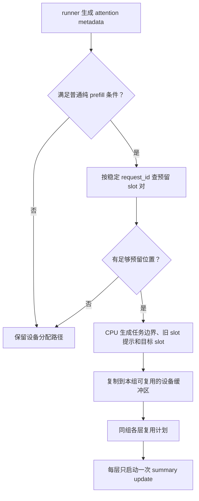

# Step5：在 model runner 中规划 prefill active slot

本方案借鉴 vLLM 的 KV block 管理方式：在模型计算前分配存储位置，模型各层只读取本批次映射。这里的 active slot 保存未完成 region 的累计状态，不是 KV cache 中单个 token 的 slot。

## 当前接入范围

第一阶段只接入普通提示词的纯 prefill 批次，包括分块 prefill。批次必须全是 prefill 请求，且本次位置仍在各请求的提示词范围内。同一 attention group 的各层须使用相同 region 大小。

混合批次、纯 decode、MTP verify、上下文并行、微批次切分和图捕获保留设备路径。没有真实请求状态的 profiling/dummy 批次也不会修改 CPU 分配记录。请求预留区耗尽时，本批次回退设备分配，不驱逐其他暂停请求的历史状态。



一次 update 不包括原有 token 布局构建和其他 attention 算子。这里省去的是 summary 更新之前的任务计数、申请判断、集中分配三次 kernel 启动。

## 分配记录存在哪里

`NPUModelRunner` 按 `(kv_cache_gid, attn_gid)` 持有独立的 `CSASlotManager`。两个编号分别标识 KV cache 组和 attention 组；不能保证布局相同的组不共享管理器。

管理器包含：

- 空闲 slot 对的 CPU 队列，每次直接取一对位置。
- `request_id → slot 对编号、上次 prefill 尾部逻辑 region、尾部 slot`。
- 三个预分配的设备缓冲区，用于存放本批次任务边界、目标 slot 和旧 slot 提示。

`request_id` 是请求生命周期内不变的身份。批次行号只表示本轮排列位置。

```text
长期记录：A → slot 对 [8, 9]；B → slot 对 [10, 11]

批次 1：[A, B] → 按 A、B 的顺序生成计划
批次 2：[B, A] → 按 B、A 的顺序生成计划

设备中的历史分子、分母仍在原 slot，不因换行而搬移。
```

真实编号从设备分配区之后开始，上例只用于说明排列。

`CSAPrefillSlotPlan` 通过 attention metadata 传给同组各层。它保存：

| 字段 | 含义 |
| --- | --- |
| `task_prefix` | 每个请求的 region 任务编号范围 |
| `source_slots[task]` | 该任务可能持有的旧预留 slot；-1 表示没有 CPU 提示 |
| `target_slots[task]` | 未完成 region 的目标 slot；完整 region 为 -1 |
| `num_tasks` | CPU 已算出的总任务数 |

物理 region 编号仍由 kernel 从已有 token 布局中读取。CPU 只根据请求长度计算逻辑 region，不新增读取设备拥有者表或分配结果的同步。builder 原有的 prefill 长度回传尚未在本次改造中消除。

## 为什么一个请求保留两个 slot

假设 region 大小为 8，A 上一轮保留了 region 10 的前半段，状态在 slot 8。这轮跨过 region 10、11，最后留下 region 12 的尾部：

```text
region 10：读取 slot 8，完成后写最终 summary
region 11：本次完整处理，不用 active slot
region 12：写 slot 9，作为下一轮历史状态
```

region 10 和 region 12 的任务可以并行执行，不能提前让新尾部覆盖 slot 8。CPU 因此让不同尾部在两个位置间交替；仍是同一个尾部时继续使用原位置。

如果旧状态来自设备分配路径，update 通过已有映射读取旧 slot，将结果写到 CPU 指定的预留 slot，然后清理旧 slot。旧 slot 提示使用前必须核对实际拥有者，不会盲目读取已被重置或更换拥有者的状态。

## 如何与 decode/MTP 共存

原有设备池大小保持不变，额外增加 CPU 预留区：

```text
[0, 8 × max_num_seqs)
    decode、MTP、回退 prefill 可以申请新位置

[8 × max_num_seqs, 10 × max_num_seqs)
    由 runner 分配，每请求一对位置
```

所有路径都能读取整个 active cache。decode/MTP 查到 prefill 留在预留区的旧状态后，可以继续读取、暂存或完成它，但其 CAS 分配仅在设备池内寻找新空位。回退 prefill 收集空位时也排除预留区。

因此，设备将预留 slot 的拥有者设为 -1，不等于该位置可以被其他请求申请；CPU 仍持有这对地址的请求级预留权。

总 active-state 容量从 `8 × max_num_seqs` 增加到 `10 × max_num_seqs`，对应这些状态数组的容量增加 25%，不是整个模型显存增加 25%。现有固定运行时状态显存估算随容量同步增加。

## 生命周期与执行顺序

- 请求换行或本轮未调度：保留预留对。
- 一个 region 完成：update 释放该 region 的设备状态，请求的地址预留仍保留。
- 请求结束、取消、抢占或 runner 调用 KV side-storage 清理：先沿用现有设备状态清理，再回收 CPU 预留对。
- 队列没有空闲预留对：回退设备路径，不覆盖暂停请求的状态。
- 设备执行失败：沿用现有报错路径；CPU 计划不是事务回滚机制，不能忽略失败继续使用计划中的状态。

计划复制、各层更新、状态清理和下一批次复用沿用 runner 的有序执行方式。缓冲区由本组管理器复用；没有为多个并发执行的同组 forward 引入独立缓冲区，因此不能脱离 runner 的执行顺序并发调用。

## 代码入口与验证状态

- [step5_csa_slot_manager.py](../vllm_ascend/worker/step5_csa_slot_manager.py)：长期预留、CPU 任务计划和设备元数据缓冲区。
- [model_runner_v1.py](../vllm_ascend/worker/model_runner_v1.py)：创建组级管理器、选择普通提示词 prefill 路径、接入清理生命周期。
- [dsa_attention.py](../vllm_ascend/models/step5/dsa_attention.py)：生成组内共享计划、携带元数据、设置分配区范围和容量。
- [summary_kernels.py](../vllm_ascend/models/step5/summary_kernels.py)：计划路径只启动 update，旧路径限制新分配范围。

按要求跳过本次测试，未验证 NPU 编译、精度、性能及端到端生命周期。此前的 GPU 精度记录和空闲列表 NumPy 模拟不覆盖这次 runner 管理方案。没有新增仓库测试文件或运行格式化流程。
